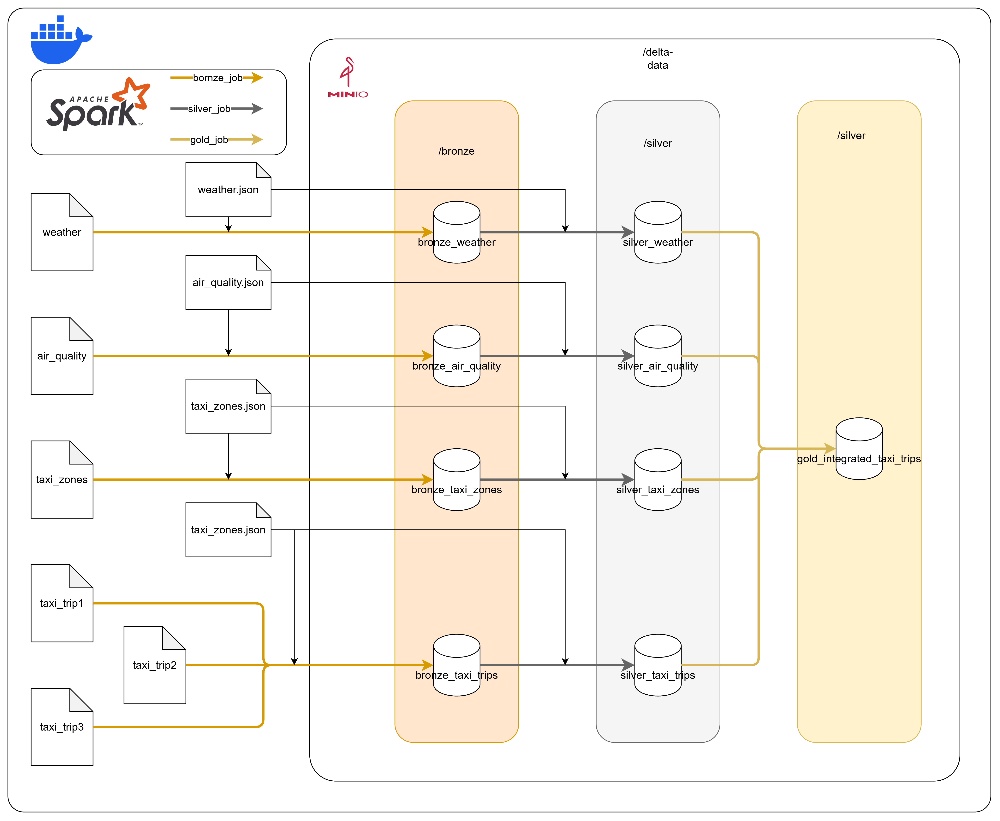

# Datasources

We have aquired data from the sources presented in the description of the assignment.
These 4 datasets are:
* Taxi trips
* Taxi zones
* Air quality
* Weather

## Taxi trips
This dataset describes a specific dataset in New York.
For the schema we used the following:
https://aqs.epa.gov/aqsweb/airdata/FileFormats.html#_format_5

## Taxi zones
This dataset describes a specific taxi zone in New York
To understand the fields we used the following documentation:
https://data.cityofnewyork.us/Transportation/NYC-Taxi-Zones/8meu-9t5y/about_data

## Air quality
Defines a set of air quality metrics for a given time in a given place defined by longitude and latitude data
For understanding the dataset we refered the following documentations:
https://aqs.epa.gov/aqsweb/airdata/FileFormats.html#_format_5

## Weather
This dataset describes a weather condition for a specific hour of a specific date in New York.
To understand the schema we used the followings:
- https://dev.meteostat.net/parameters
- https://www.ncei.noaa.gov/pub/data/noaa/isd-lite/isd-lite-format.pdf

# Storage Architecture

To store the data we used the medallion architecture which is a commonly used practice working with delta and bigdata.

## Bronze layer

We land the raw data from the different datasources in the bronze layer without any transformation applied.

## Silver layer

We load the data from the bronze to the silver layer and during we apply a different set of transformations:
- renaming
- assigning correct datatypes
- validating the data
- validating the datatypes
- deriving new columns

## Gold layer

We load the data from the silver to the gold layer and on the way apply transformation to create a presentation ready dataset, which contains all related data to a specific taxi trip.
We apply:
- joining to other tables
- cleaning the data
- deriving columns
- dropping unnecessary columns

## Architectural diagram

