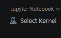
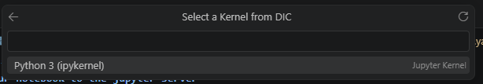
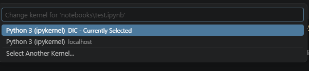

# How to connect your notebook to the jupyter server

1. Open your notebook and click `Select Kernel` in the upper right corner 
1. Select `Existung Jupyter Server`
1. Type in `http://127.0.0.1:8888`
1. Accept the connection over http

1. Name your connection

1. Select the python 3 kernel

Now you can run your notebook connecting to that environment and next time when you want to connect just select the created server
